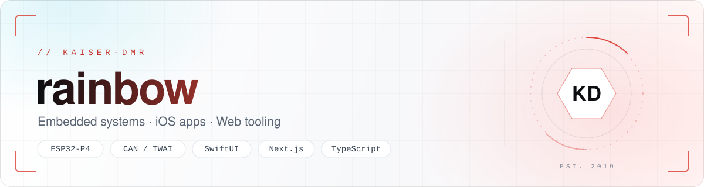

  <picture>
    <source media="(prefers-color-scheme: dark)" srcset="./assets/hero-dark.svg">
    <source media="(prefers-color-scheme: light)" srcset="./assets/hero-light.svg">
    
  </picture>

  
  
  

 

## 关于 / About

写完整链路的人：**固件 → 网页仪表盘 → 原生 App**。

2019 年注册账号，从 Vue 后台管理页面写起；2022 年一个 3D 心跳页面意外被 fork 了 180 多次；
现在主要在折腾 **P4-CAN** 这条线 —— 跑在 ESP32-P4 上的三路 CAN 工具固件、板子自带的网页仪表盘，
以及装进 iPhone / Mac 的原生控制台。

习惯把「能不能用」放在「写得优雅」前面：能一条命令还原的改动，就不做不可逆的魔改；
能回读校验的写入，就不假设它成功了。

 

## 现在在做什么 / Now

- 🛠 &nbsp;**P4 管家 3.44** — SwiftUI 重写的 iOS / iPadOS / macOS 控制台，把状态、灯光、诊断做成可视化面板，写入后回读校验。
- 🌏 &nbsp;**P4-CAN 汉化壳** — 注入式中文化，不动固件一行逻辑；外加一层原生 iOS 外壳，刷原厂英文固件也有中文界面。
- 📊 &nbsp;**TikTok 广告批量搭建后台** — Next.js + Marketing API 的投放作业台（私有项目）。

> 车载相关项目与 Tesla, Inc. 无任何关联。CAN 写入有风险，请仅在驻车或封闭场地、并遵守当地法律法规的前提下使用。

 

## 精选项目 / Featured

| 项目 | 说明 |
| :-- | :-- |
| **[P4 管家 · P4-CAN Companion](https://github.com/Kaiser-DMr/p4can-companion)** `SwiftUI` `ESP32-P4` `iOS 17+` `macOS 14+` | 原生 iOS / iPadOS / macOS 控制台。所有状态直接来自设备 HTTP API，不是网页套壳；写入后回读校验。ad-hoc IPA 需自行签名。 |
| **[P4-CAN 中英双语汉化](https://github.com/Kaiser-DMr/p4can-zh-ios)** `JavaScript` `WKWebView` `Sideload` | 给 P4-CAN 网页仪表盘做的注入式汉化 + 原生 iOS 外壳。不改固件逻辑，一条命令即可还原英文；未连设备时可进「界面预览」。 |
| **[3D 心跳 · -3D](https://github.com/Kaiser-DMr/-3D)** `JavaScript` `CSS 3D` | 纯前端的 3D 爱心跳动页面，2022 年的意外小爆款（200+ ★ / 180+ fork），至今仍有人拿去做表白页。 |
| **[广告后台 · ads--admin-code](https://github.com/Kaiser-DMr/ads--admin-code)** `JavaScript` `Vue` | 广告投放后台的全代码实现，早期前端工程化的练习沉淀。 |

 

## 技术栈 / Stack

`嵌入式`&nbsp;

`Apple`&nbsp;

`Web`&nbsp;

`工具`&nbsp;

 

## 数据 / Stats

  <picture>
    <source media="(prefers-color-scheme: dark)" srcset="https://github-readme-stats.vercel.app/api?username=Kaiser-DMr&show_icons=true&hide_border=true&rank_icon=github&bg_color=0B0D10&title_color=FF6B6B&icon_color=FF4D4D&text_color=C9D1D9&card_width=420">
    
  </picture>
  <picture>
    <source media="(prefers-color-scheme: dark)" srcset="https://github-readme-stats.vercel.app/api/top-langs/?username=Kaiser-DMr&layout=compact&langs_count=8&hide_border=true&bg_color=0B0D10&title_color=FF6B6B&text_color=C9D1D9&card_width=380">
    
  </picture>

 

  暂居地球 🌍 · 随时上线

